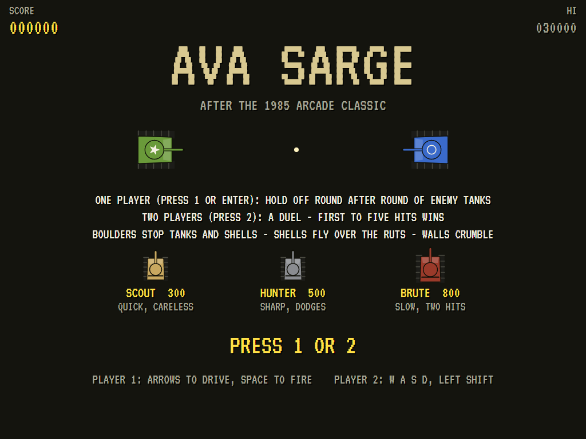
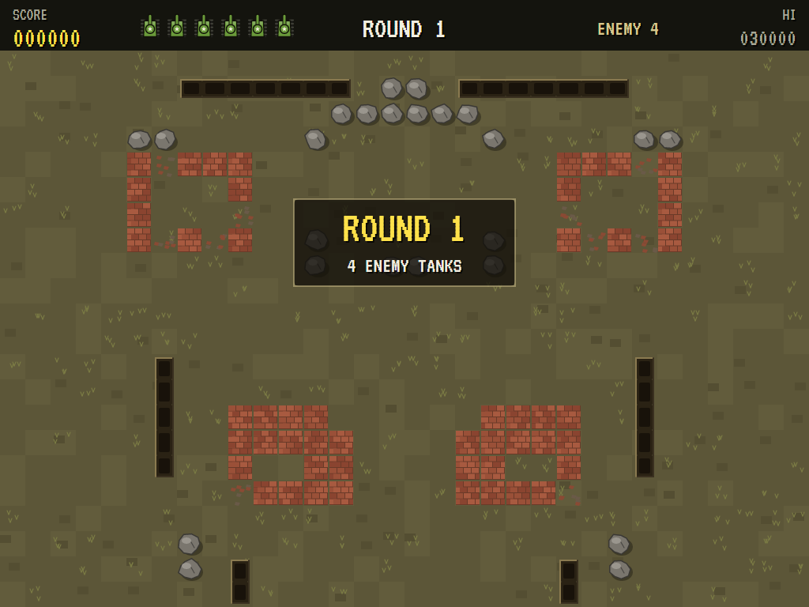
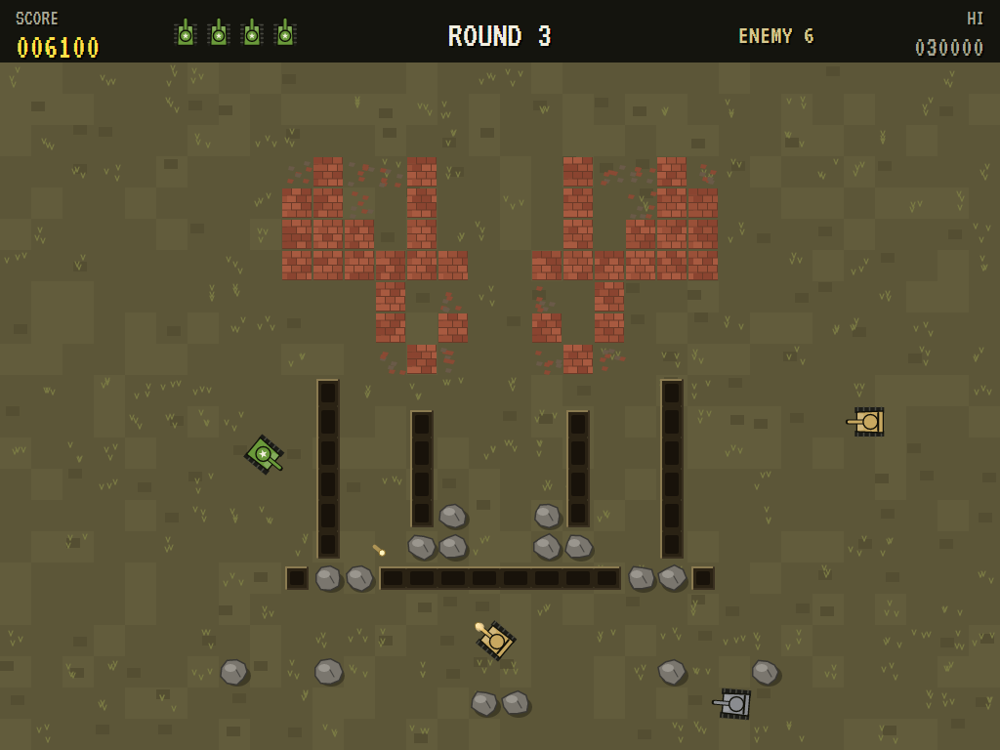
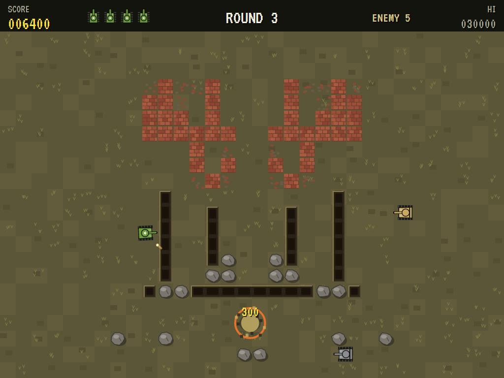
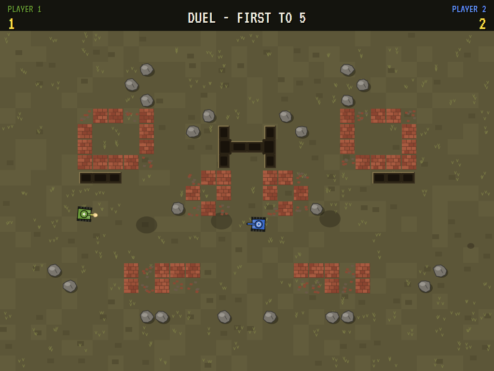
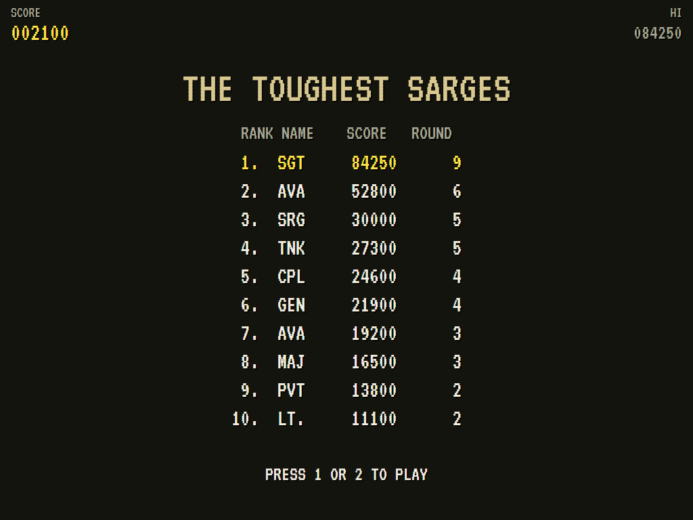

# AVA Sarge

[](https://github.com/Harlock123/AVASarge/actions/workflows/build.yml)

A top-down tank battle for one or two players in the style of Bally Midway's 1985 arcade game **Sarge**,
built with .NET 10 and Avalonia UI. Drive your tank across a battlefield of boulders, deep ruts and ruined
buildings, line up your gun and get your shot in first. Play alone against round after round of enemy
tanks, or two players head to head, first to five hits.

## Features

- **The battlefield**: open ground, churned and scorched, broken up by obstacles. It's laid out the same on the left as on the right, so a duel is fair, and a new one comes each round.
  - **Boulders** stop tanks and shells.
  - **Deep ruts** no tank can cross, but shells fly over them.
  - **Ruined buildings** stop tanks and shells until their walls crumble to rubble under fire. Tanks can then cross the rubble, slowly.
- **The tanks**:
  - **Controls:** classic tank controls. Turn left or right, roll forward or back, and fire straight ahead.
  - **Shells:** one shell in the air at a time.
  - **Rolling out:** a tank that rolls out is safe for a moment.
- **One player**: you're the Sarge, in the green tank with the star. Enemy tanks roll out on the far side a few at a time, and more come each round.
  - **Scouts** are quick but careless.
  - **Hunters** are sharp-eyed and swerve out of the way of your shells.
  - **Brutes** are slow and take two hits.
  - **How they fight:** they work their way round the obstacles to get a clear shot, hold their aim a moment and fire.
  - **Losing a tank:** when you lose one, they pull back and come again.
- **Two players**: a duel on one keyboard (or two gamepads), each from your own side of the battlefield. Every hit scores, and the first to five wins.
- **Scoring** (one player): Scouts 300, Hunters 500, Brutes 800, 1,000 × the round number for clearing a round, and an extra tank at 20,000 and every 50,000 after that.
- **Sound**:
  - **The music:** a marching snare under a brass line for the battle, and a proud march for the title, all new.
  - **The effects:** the guns, clangs on armour, tanks going up, walls crumbling, and bugle calls.
  - All of it is synthesised and mixed by OpenAL.
- **Attract mode**: leave the title alone for 15 seconds and the computer drives your tank against the enemy, with a Hunter's brain.
- **A top-ten high-score table** (one player) with arcade-style initials entry. It records the round reached.
- **Gamepads** through SDL2: the first for player one, the second for player two.
- **Any window size**: the screen scales to fit, letterboxed. **Ctrl+S** saves a screenshot.
- **One self-contained executable** per platform: Windows, macOS and Linux on Intel/AMD and ARM.

## Screenshots

| The title | Round 1 | The battle |
|:---------:|:-------:|:----------:|
|  |  |  |
| One player or two. | Rolling out. | Scouts, a Hunter, ruts and ruins. |

| A tank goes up | The duel | The toughest sarges |
|:--------------:|:--------:|:-------------------:|
|  |  |  |
| A hit. | Player one against player two. | The high-score table. |

The screenshots are made by the tests, which play the game in a real (headless) window; see
[Tests](#tests).

## Download and run

Ready-to-run builds for Windows, macOS and Linux, on both Intel/AMD and ARM, are on the
[Releases page](https://github.com/Harlock123/AVASarge/releases/tag/latest). **Latest build** is rebuilt
on every push to `main`. Each download is one self-contained executable: no .NET install is needed.

| Platform | Archive |
|---|---|
| Windows | `AVASarge-win-x64.zip`, `AVASarge-win-x86.zip`, `AVASarge-win-arm64.zip` |
| macOS | `AVASarge-osx-arm64.tar.gz` (Apple silicon), `AVASarge-osx-x64.tar.gz` (Intel) |
| Linux | `AVASarge-linux-x64.tar.gz`, `AVASarge-linux-arm64.tar.gz`, `AVASarge-linux-arm.tar.gz` |

```bash
tar -xzf AVASarge-linux-x64.tar.gz     # or linux-arm64, linux-arm, osx-arm64, osx-x64
./AVASarge
```

On Windows, unzip and run `AVASarge.exe`. On macOS, if Gatekeeper refuses to open it, run
`xattr -d com.apple.quarantine AVASarge` once. Run with `--no-audio` for silence.

**Sound** comes through OpenAL Soft, built in for every platform. In a virtual machine the game
detects it and uses a larger audio buffer, so the sound doesn't break up.

**Gamepads** use SDL2, which is bundled for Windows, macOS and Intel/AMD Linux. ARM Linux builds need it
installed; without it the keyboard still works:

```bash
sudo apt install libsdl2-dev            # Debian / Ubuntu / Raspberry Pi OS
sudo pacman -S --needed sdl2-compat     # Arch / Omarchy
```

## Controls

| Input | Player one | Player two |
|-------|------------|------------|
| Start | **1** or **Enter** (one player); **2** starts a two-player duel | |
| Turn | **Left** / **Right** | **A** / **D** |
| Forward / back | **Up** / **Down** | **W** / **S** |
| Fire | **Space** (or **Right Ctrl**) | **Left Shift** (or **Tab** or **Q**) |

Playing alone, either set of keys drives your tank. **P** / **Esc** pause (Esc again to quit), **M** mutes,
and **Ctrl+S** saves a screenshot to the Pictures folder.

**Gamepads**: the first for player one, the second for player two. The left stick or D-pad turns and
drives, and **A**, **B** or **X** fires. **Start** on the first pad starts a one-player game and on the
second a duel, and either pauses. **Back** (while paused) quits.

**Entering initials**: type letters, or dial with **Up**/**Down** and accept with **Space**; **Left** /
**Backspace** go back; **Enter** finishes.

## Tests

```bash
dotnet test AVASarge.slnx
```

The engine has no UI and runs in fixed 60 Hz steps, so it plays the same at any frame rate, and a seed
always plays the same game. The tests check:

- **The battlefield:** the same both sides, every place a tank rolls out reachable and clear, with boulders, ruts and walls
- **Driving:**
  - forward, back and turning
  - boulders and ruts stopping a tank, and rubble slowing it
- **Shells:**
  - one at a time
  - flying over ruts, bursting on boulders, and walls crumbling to rubble
  - enemy tanks going down for their points, and a Brute taking two
- **The enemy:**
  - a computer tank working its way round to a clear shot
  - your tank lost, and the next rolling out safe with the enemy pulled back
  - the last tank ending the game
- **Rounds:** enemy tanks a few at a time, the round won and the next with more, and an extra tank
- **The duel:** started with 2, each hit scoring for the shooter, the first to five winning and the game going back to the title
- **The machine:** the computer holding its own at your tank, the attract cycle, the same game from the same seed, initials and the high-score file

The screenshot tests draw the real screen in a headless window. To refresh the README's pictures:

```bash
SARGE_SHOTS=$PWD/Images dotnet test tests/AVASarge.Tests --filter ScreenshotTests
```

To see how the computer gets on at your tank, round by round (for tuning), or how a player who just sits
and fires does (`SARGE_PROBE=lazy`):

```bash
SARGE_PROBE=1 dotnet test tests/AVASarge.Tests --filter PilotProbe --logger "console;verbosity=detailed"
```

## Building

```bash
dotnet build AVASarge.slnx
dotnet run --project src/AVASarge
```

Needs the .NET 10 SDK. The sounds are made by `tools/make_sounds.py` (standard-library Python):
`python3 tools/make_sounds.py` rewrites `src/AVASarge/Sounds`.

## Project structure

```
AVASarge/
├── AVASarge.slnx
├── src/AVASarge/
│   ├── Engine/
│   │   ├── GameEngine.cs        # States, one player or two, the title and demo cycle, and the music
│   │   ├── GameEngine.Play.cs   # Driving and firing, shells, walls crumbling, the enemy's rounds, the duel
│   │   ├── Battlefield.cs       # Each battlefield: boulders, ruts and ruins, mirrored; clear shots
│   │   ├── TankAi.cs            # How the computer drives a tank (and your tank, in the demonstration)
│   │   ├── Entities.cs
│   │   ├── HighScoreTable.cs, InitialsEntry.cs
│   │   ├── InputHandler.cs, ControllerManager.cs  # Both players' keys and two SDL2 gamepads
│   │   └── SoundManager.cs      # Effects and the tunes through OpenAL
│   ├── Audio/                   # The OpenAL engine (from the author's AVABand)
│   ├── Views/                   # The battlefield, the tanks, shells and blasts, the screens
│   └── Sounds/                  # The synthesised effects and tunes
├── tests/AVASarge.Tests/        # Gameplay, screenshot and probe tests
├── tools/make_sounds.py
└── Images/                      # Screenshots
```

## About and licence

AVA Sarge © 2026 Lonnie Watson, under the [MIT License](LICENSE).

*Sarge* © 1985 Bally Midway; the name belongs to its current owner. AVA Sarge is an independent, unofficial
game in its style. Its tanks, battlefields, graphics, sounds, tunes and code are its own; nothing is taken
from the arcade machine's program, graphics, sound or music. It is not affiliated with or endorsed by any
rights holder.
